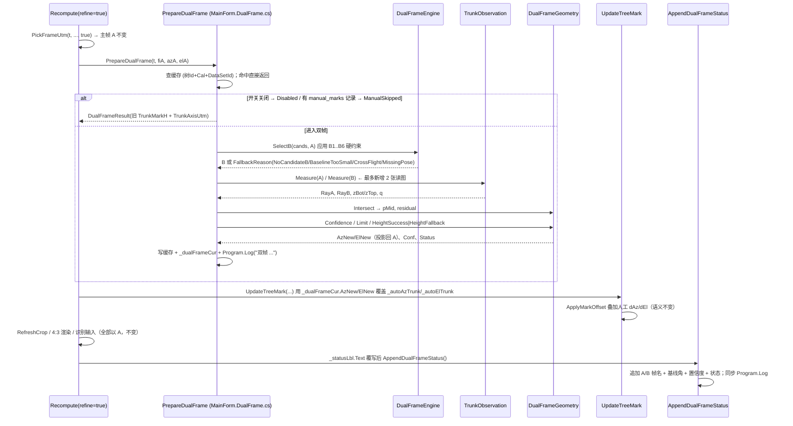

# ARCH｜双帧交会定位（增量架构设计·最小可执行版）

> 历史设计记录：本文中的 `MainForm`、WinForms 和旧构建脚本对应旧版本。当前实现已改为无窗口的 `BackendSession`，以 `desktop-js/README.md` 和当前源码为准。

> **文档类型**：增量架构设计与任务拆解（不含实现代码、不改动源码）
> **适用**：`E:\树木识别\TreeExtract`，C# / .NET Framework 4.x / WinForms，20 个 .cs，`build.ps1`，**无新增依赖**
> **上游**：`docs\research\PRD-双帧交会定位.md`（§4 约束 / §5 P0 / §6 核心需求 / §8 验收 / §10 回归用例）
> **口径优先级**：本文以主理人 8 条定案为最高约束；与 PRD §6.3 不一致处以定案为准，差异在 §9 显式列出。
> **作者**：高见远（架构师）

---

## 1. 方案一句话 + 回退链

**一句话**：在 `Recompute(refine=true)` 选中树路径上挂一条**只读旁路**——主帧 A 完全沿用现有选帧结果，另从同架次合格候选里挑视角分离的副帧 B，各自在全景 ROI 内量测树干轴心像素并反投影成观测射线，两射线最小二乘交会得水平位置、两帧共同可见段中点得高度，投影回**主帧 A** 画面产出新的 `_autoAzTrunk/_autoElTrunk`；A 的 4:3 渲染 / 切图 / 识别输入 / 热力图一概不动。

**回退链（自上而下，命中即停）**

| 序 | 条件 | 锚点高度 | 锚点横向 | 状态 |
|---|---|---|---|---|
| 1 | 开关关闭 | `TrunkMarkH(H)=clamp(0.042H,0.42,0.75)` | `TrunkAxisUtm` → 缺则 `bearing+TrunkAzBias(2.7°)` | `Disabled` |
| 2 | 该树有 `manual_marks.csv` 记录 | **旧** `TrunkMarkH(H)` | 同上（旧自动锚点） | `ManualSkipped` |
| 3 | 开关开、双帧**失败**（任一回退原因） | **新** `clamp(0.12H, 0.8m, min(0.35H,2.0m))` | `TrunkAxisUtm` → 缺则 `bearing+TrunkAzBias` | `Fallback` + 具体原因 |
| 4 | 开关开、交会**成功** | `clamp(zMidCommon, 0.8m, min(0.35H,2.0m))` | 交会水平点 `(X,Y)` 投影回 A | `Success`（可带限幅子标记） |

> **定案要点（覆盖 PRD §6.3 第 3/4 步）**：只有「开关关闭」与「人工优先」两态使用旧高度，保证 9.13 基线逐项一致与历史 `dAz/dEl` 不漂移；**开关开启但交会失败仍使用新居中高度**，仅横向退回 `trunk.csv`，用于即使无冗余观测也先把红圈抬高。人工偏移始终由既有 `ApplyMarkOffset` 叠加，语义不变。

---

## 2. 新增类 / 字段 / 缓存 / 状态枚举 / 配置参数（签名级伪接口）

全部置于 `namespace TreeExtractor`；新类型放 `src\DualFrame\`，`MainForm` 的新增成员集中在**新增 partial 文件** `src\MainForm.DualFrame.cs`，避免侵入既有大文件。

### 2.1 配置参数（`src\DualFrame\DualFrameConfig.cs`）

```csharp
static class DualFrameConfig {
    public const bool   EnabledDefault        = true;
    public const double BaselineAngleMinDeg   = 15.0;   // A/B 水平方位夹角下限
    public const double SameFlightMaxDeltaSec = 600.0;  // 帧名 GPS 时间差上限（同架次判据）
    public const double ConfMin               = 0.5;    // 置信度下限
    public const double LimitAzDeg            = 5.0;    // 方位修正限幅
    public const double LimitElDeg            = 6.0;    // 仰角修正限幅
    public const double ResidualMaxM          = 0.6;    // 交会残差上限
    public const double HeightK               = 0.12;   // 失败态新居中高度系数
    public const double HeightFloorM          = 0.8;
    public const double HeightCeilRatio       = 0.35;   // 不进入分叉/树冠
    public const double HeightCeilAbsM        = 2.0;
    public const int    MaxExtraFrameLoads    = 2;      // 副帧读图 ≤2 张/树
    public const int    RoiSmallW  = 1440, RoiSmallH = 720;   // 复用 RoiQuality 口径
    // 置信度权重：残差 / 基线角 / 两帧质量 / 姿态完整性
    public static readonly double[] ConfW = { 0.35, 0.25, 0.25, 0.15 };
}
```

> 阈值集中于此（P1-3），禁止散落硬编码；`0.12 / 0.8 / 0.35H / 2.0` 为初值，离线回放（P1-2）后可整体调参。

### 2.2 类型与状态枚举（`src\DualFrame\DualFrameTypes.cs`）

```csharp
enum DualFrameStatus { Disabled, ManualSkipped, Success, Fallback }

enum FallbackReason {
    None, NoCandidateB, BaselineTooSmall, CrossFlight, MissingPose,
    MissingTrunkCsv, ObservationFailed, ResidualTooLarge,
    LowConfidence, AbnormalHeight, LimitExceeded, Exception
}

struct Vec3 { public double X,Y,Z; }
struct Ray3 { public Vec3 O, D; }                       // D 为单位向量

class DualFrameResult {
    public DualFrameStatus Status;
    public FallbackReason  Reason;
    public string FrameA, FrameB;                       // 帧名（失败时 B 可空）
    public double BaselineAngleDeg, ResidualM, Confidence;
    public double AzOld, ElOld, AzNew, ElNew;           // 主帧 A 画面上的自动锚点
    public double HeightM;                              // 最终采用的锚点高度
    public bool   LimitClamped;                         // 是否触发限幅截断
    public string StatusText { get; }                   // 供状态栏/日志/CSV 复用，单行
}

readonly struct DualFrameCacheKey : IEquatable<DualFrameCacheKey> {
    public readonly int TreeId; public readonly double Cal; public readonly string DataSetId;
}
```

### 2.3 缓存与 `MainForm` 新增成员（`src\MainForm.DualFrame.cs`）

```csharp
public partial class MainForm {
    CheckBox _chkDualFrame;                                   // 默认 Checked=true
    readonly Dictionary<DualFrameCacheKey, DualFrameResult> _dualFrameCache
        = new Dictionary<DualFrameCacheKey, DualFrameResult>();
    DualFrameResult _dualFrameCur;                            // 当前树结果，供三处消费者共享
    string _dataSetId;                                        // LoadUtmData 时由树心文件路径生成

    DualFrameResult PrepareDualFrame(UtmTree t, FrameInfo fiA, double azA, double elA); // 编排入口
    void AppendDualFrameStatus();                             // _statusLbl.Text 覆写后追加
    void InvalidateDualFrame(int treeId, bool all);           // 人工「保存校正/重置为自动」时失效
    void ClearDualFrameCache();                               // LoadUtmData 重载时调用
    static string DataSetIdOf(string treeCentersPath);
    static double GpsSeconds(FrameInfo fi);                  // 解析 fi.Gps → 秒，供同架次判定
}
```

**缓存键**：`树Id + Cal + 数据集标识`（主理人定案第 7 条）。`CalV` **不进键**：观测射线由图像像素经 `PanoRefOf(frame) + Cal` 反投影，仰角按等距柱状行坐标反算，均不引入 `CalV`（`CalV` 是视图渲染层偏移，与相机姿态坐标系分离）→ 对应 §9-Q9 结论「本期 CalV 不参与交会」，R16 只记录结论不刷新结果；若后续纳入，须同步把 `CalV` 加入键。

### 2.4 既有只读接口（不改，仅调用）

`PanoRefOf(frameName)` / `PanoAzimuthFromOpk(ω,φ,κ)`、`TrunkMarkH(H)`、`TrunkAxisUtm(t,out tux,out tuy)`、`TrunkAzBias`、`UtmForest.TreeAzim(x,y,z,camX,camY,camZ,out az,out el,out d0)`、`Geo.Wrap360/Rad/Deg/Dist2D`、`Proj.PixelFromWorld/WorldFromPixel`、`FrameCandidate{Index,Dh,ElA,ElB,ElT,AzT,A0,Occ,Q}`、`RoiQuality(Bitmap,UtmTree,FrameCandidate)`、`_metaPose: Dictionary<string,double[6]>`（帧名→[X,Y,Z,Ω,Φ,K]）、`_frames.Load(name)`、`Program.Log(string)`。

---

## 3. 双帧选择策略

**主帧 A**：直接取 `PickFrameUtm(t, out d, out az, out el, true)` 的既有结果（`_manualFrameIdx` → `fi`），`dist/bearing/elev/_pickAng` 一概不动；`PickFrameUtm` / `RefineFrameChoice` / `_refinedChoices` / `AutoSelectStartupTree` **不改一行**。

**副帧 B 候选池**：复用 `PickFrameUtm` 内部已通过硬约束筛出的 `cands`（`DLO=2.5 / DHI=30` 距离窗、拍摄者扇区 `[45°,125°]` 排除、`off>60°` 排除、整树入框 `spanF ≤ VF43Max+8`），**不新增放宽**。为不改动该函数，采用「同口径重筛」：`DualFrameEngine` 按同一组硬约束在 `_metaPose` 上重建候选列表（只读，不写回 `cands`），逐条应用：

| 序 | 判据 | 不满足 |
|---|---|---|
| B1 | `B.Index != A.Index` | 排除 |
| B2 | `_metaPose.ContainsKey(B.Name)` 且位姿完整（6 自由度） | `MissingPose` |
| B3 | `|GpsSeconds(B) - GpsSeconds(A)| ≤ 600s`（**同架次**，禁止跨架次，覆盖 Q2/R14） | `CrossFlight` |
| B4 | `BaselineAngle = |Wrap180(AzCamA→树心 − AzCamB→树心)| ≥ 15°` | `BaselineTooSmall` |
| B5 | 相机基线长度 `Dist2D(camA−camB) ≥ 基线长度下限`（防退化，取 `0.15·min(DhA,DhB)`） | `BaselineTooSmall` |
| B6 | B 自身质量 `Q ≥ 池内质量分位下限`（复用 `RoiQuality` 口径，不额外读图超过 2 张） | 降权 |

**择优**：在满足 B1–B6 的帧里取 `argmax( 0.6·Norm(BaselineAngle) + 0.4·Norm(Q_B) − 1.5·Occ_B )`（与 `RefineFrameChoice` 的 `Q − 1.5·Occ` 同精神，低质量 B 直接判回退，Q7）。池内无合格 B → `NoCandidateB`；**P1-1** 可在保持 B1–B6 全部硬约束的前提下扩大一次搜索半径再挑一次，仍不得增加启动读图。

**同架次与 D3 风险**：`dataset_runtime_full` 为两架次合并 + Pix4D 局部坐标 + IMU 航向近似（注释实测偏差约 90°）。B3 从时间维切断跨架次配对；若同一架次内方位仍来自 `PanoAzimuthFromOpk` 的 IMU 回退，则置信度的「姿态完整性」项降为 0.5，低于 `ConfMin` 自动回退，避免系统性大偏移（Q2）。

---

## 4. 图像侧量测 → 反投影 → 交会 → 置信度 → 限幅 → 高度公式

### 4.1 图像侧树干量测（`src\DualFrame\TrunkObservation.cs`）

```csharp
static class TrunkObservation {
    // small = _frames.Load(name) 缩到 1440×720 后的位图（与 RoiQuality 完全同口径）
    // 返回该帧对树干的观测射线：方向由「轴心像素列 + 可见段中点行」反投影
    public static bool Measure(Bitmap small, FrameCandidate c, UtmTree t,
                               double[] mp, double cal,
                               out Ray3 ray, out double zBot, out double zTop,
                               out double quality);
}
```

步骤：① ROI 列中心 `cx = Geo.Rad(c.AzT - c.A0)/(2π)·W`（同 `RoiQuality:111`），行范围由 `c.ElB/c.ElT` 映射 `cy=(90−el)/180·H`，ROI 左右各留 ±`0.35·|ElT−ElB|` 对应列宽；② ROI 内逐像素算轻量垂直梯度 `|Gy|` + 颜色判据（低亮/低饱和偏褐的树干 vs 高亮偏绿背景）加权，沿行累加成**树干响应列剖面**；③ 取响应峰的加权质心为轴心像素列 `u*`，峰对比度 `(peak−median)/(peak+eps)` 过低 → `ObservationFailed`；④ 沿 `u*` 列在 `[ElB,ElT]` 内取连续高响应段，得可见段上下界行 `vTop/vBot`；⑤ `quality = 对比度 × 段长占比 × (1 − 0.15·Occ)`，归一化到 `[0,1]`。

**反投影（关键：不得由理论树点反算）**：由像素得世界角
`azPix = Wrap360(c.A0 + (u*/W)·360)`，`elPix = 90 − (v*/H)·180`（`v*` 取可见段中点行）；
`ray.O = (mp[0], mp[1], mp[2])`；
`ray.D = (cos(elPix)·sin(azPix), cos(elPix)·cos(azPix), sin(elPix))`（用 `Geo.Rad`）。
`zBot/zTop` 由 `vBot/vTop` 沿该射线在树附近水平距离 `c.Dh` 处换算成相对树底 `t.Z` 的高度区间。射线**只来自图像量测**，因此两射线一般不严格相交，交会产生真实修正量（§1 核心边界 / Q1）。

### 4.2 交会（`src\DualFrame\DualFrameGeometry.cs`）

```csharp
static class DualFrameGeometry {
    public static bool Intersect(Ray3 a, Ray3 b, out Vec3 pMid, out double residualM);
    // 两射线最近点闭式解：解 2×2 线性方程 [d1·d1,−d1·d2; d1·d2,−d2·d2]·[s1,s2]=[(P2−P1)·d1,(P2−P1)·d2]
    // pMid = 0.5·(P1+s1·d1 + P2+s2·d2)；residualM = |(P1+s1·d1) − (P2+s2·d2)|
    public static double Confidence(double residualM, double baselineDeg,
                                    double qA, double qB, double poseIntegrity);
    public static void Limit(double azOld, double elOld, ref double azNew, ref double elNew,
                             out bool clamped);
    public static double HeightSuccess(double zMidCommon, double H);
    public static double HeightFallback(double H);
    public static double TrunkMarkHLegacy(double H);   // 转调 MainForm.TrunkMarkH，仅供对照/日志
}
```

- **水平位置**：取 `Intersect` 的 `pMid.X/Y`；`residualM > ResidualMaxM(0.6m)` → `ResidualTooLarge`。
- **高度（成功态）**：`zMidCommon = 0.5·( max(zBotA,zBotB) + min(zTopA,zTopB) )`；若上界 < 下界（两帧无共同可见段）→ `ObservationFailed`；再 `HeightSuccess = clamp(zMidCommon, 0.8m, min(0.35H, 2.0m))`。
- **高度（失败态）**：`HeightFallback = clamp(0.12H, 0.8m, min(0.35H, 2.0m))`；`0.35H` 上限保证不进入分叉/树冠（PRD Q4）。树高 `H ≤ 0` 或 `H` 与冠幅明显不符 → `AbnormalHeight`。
- **投影回主帧 A（必须）**：`UtmForest.TreeAzim(pMid.X, pMid.Y, t.Z + HeightM, camXA, camYA, camZA, out azNew, out elNew, out _)`。红圈画在 A 帧上，故修正后的 3D 点必须投影回 **A 的姿态**（不是 B，也不用平均），与「渲染仍以 A 为准」一致。

### 4.3 置信度

```
f_resid = clamp(1 − residualM / 0.6,                 0, 1)
f_base  = clamp((baselineDeg − 15) / (35 − 15),       0, 1)
f_qual  = min(qA, qB)                                       // 两帧质量取短板（Q7）
f_pose  = 1.0（两帧均 6DOF Metashape）/ 0.5（任一帧 IMU 回退）/ 0（缺失→直接回退）
Confidence = 0.35·f_resid + 0.25·f_base + 0.25·f_qual + 0.15·f_pose
```
`Confidence < 0.5` → `LowConfidence` 回退。

### 4.4 限幅保护

`dAz = Wrap180(azNew − azOld)`、`dEl = elNew − elOld`；若 `|dAz|>5°` 或 `|dEl|>6°`，按阈值**截断**（不是丢弃），`clamped=true`，并把置信度乘 `0.8` 折减；折减后 `<0.5` → `LimitExceeded` 回退。避免异常交会把手圈甩出树外（B3/R04）。

---

## 5. 调用流程



**触发约束**：仅 `Recompute` 中 `auto==true && selUtm 有效 && PickFrameUtm(...,true)` 路径；`AutoSelectStartupTree` 的 `refine=false` 全量选帧**不调用** `PrepareDualFrame`（E1：启动阶段双帧计算 0 次、新增读图 0 张）。拖准心 / 切图重算一律走缓存，不重复交会。

---

## 6. 文件清单与插入点

### 新增（6 个 .cs，`build.ps1` 现有 glob 应可自动收集，需工程师核对，不新增 NuGet / 不改 csproj）

| 文件 | 职责 |
|---|---|
| `src\DualFrame\DualFrameConfig.cs` | §2.1 全部阈值常量、置信度权重 |
| `src\DualFrame\DualFrameTypes.cs` | §2.2 枚举 / `Vec3` / `Ray3` / `DualFrameResult` / 缓存键 |
| `src\DualFrame\TrunkObservation.cs` | §4.1 图像侧量测 + 反投影 |
| `src\DualFrame\DualFrameGeometry.cs` | §4.2–4.4 交会 / 置信度 / 限幅 / 高度 |
| `src\DualFrame\DualFrameEngine.cs` | §3 选 B、回退链优先级、缓存、状态串、回放 CSV（T05） |
| `src\MainForm.DualFrame.cs` | §2.3 `partial class MainForm` 字段、`PrepareDualFrame` / `AppendDualFrameStatus` / 失效与清空 / 日志 |

### 修改（4 个既有文件，均为**最小插入**，不改既有算法）

| 文件 | 插入点 | 改动 |
|---|---|---|
| `src\MainForm.Frames.cs` | ① `:305` 之后 `fi` 确定处、调用 `UpdateTreeMark` 之前 | 一行 `var dfr = PrepareDualFrame(t, fi, az, el);` |
| | ② `:219–230` 红圈锚点段 | 用 `_dualFrameCur.AzNew/ElNew/HeightM` 覆盖 `_autoAzTrunk/_autoElTrunk`；**保留**原 `TrunkMarkH+TrunkAxisUtm` 分支作为 `Disabled/ManualSkipped` 路径 |
| | ③ `:402` `_statusLbl.Text = ...` 之后 | 一行 `AppendDualFrameStatus();`（必须在覆写后，否则被冲掉） |
| `src\MainForm.Ui.cs` | `:146` 高级参数区 `_advPanel/gpParams` | 新增 `CheckBox _chkDualFrame`「自动双帧交会定位」`Checked=true` |
| | `:200` `_lblMarkMode` | 文案扩为 4 态：`当前：自动（双帧交会）` / `当前：自动（树干锚点·单帧回退）` / `当前：手动（已校正）` / `当前：人工优先（已跳过双帧）` |
| `src\MainForm.Data.cs` | `:19` `LoadUtmData` → `_refinedChoices.Clear()` 旁 | `ClearDualFrameCache()` + 重算 `_dataSetId = DataSetIdOf(树心文件路径)` |
| `src\MainForm.MarkStore.cs` | 只读查询 | 暴露 `bool HasManualMark(int treeId)`；「保存校正 / 重置为自动」后调 `InvalidateDualFrame(treeId,false)`。**CSV 格式 / 路径 / 表头 / dAz,dEl 语义一律不改** |

### 只读核对（不改）

`MainForm.cs`（`AimHeight`/`TrunkMarkH`/`TrunkAxisUtm`/`PanoRefOf`）、`MainForm.FrameQuality.cs`（`cands` / `RefinedChoice` 范式 / `RoiQuality`）、`MainForm.Photo.cs`（`ComputeMarkFracs`/`SetManualMark` 消费自动基准）、`Geometry.cs`、`Proj.cs`、`build.ps1`。

### 产出物

`outputs\双帧交会回放.csv`（P1-2：树号,A,B,基线角,残差,置信度,修正前后 Az/El,状态,原因）、状态串日志、`docs\research\ARCH-双帧交会定位.md`（本文）。

---

## 7. 给工程师的有序任务列表

> 5 个任务，按依赖排序；T02/T03 仅依赖 T01，可并行开发。每任务列出验收点，全部对应 PRD §8/§10。

| ID | 任务名 | 源文件 | 依赖 | 优先级 | 验收点 |
|---|---|---|---|---|---|
| **T01** | **基础设施层**：配置/类型/全局字段/人工查询/依赖确认 | `DualFrameConfig.cs`(新)、`DualFrameTypes.cs`(新)、`MainForm.DualFrame.cs`(新·桩与字段)、`MainForm.MarkStore.cs`(改·`HasManualMark`)、`build.ps1`(核对) | — | P0 | 编译通过；`_chkDualFrame` 默认开；阈值零硬编码散落；`HasManualMark` 对 105/106/108/110/111/112/117 返回 true；**无新 NuGet、无 csproj 改动、新增 .cs 被 build.ps1 收集**；`_dualFrameCache` 可在 `LoadUtmData` 清空 |
| **T02** | **几何与图像量测层**（纯新增，可独立单测） | `TrunkObservation.cs`(新)、`DualFrameGeometry.cs`(新)、`Geometry.cs`/`Proj.cs`/`MainForm.cs`(只读复用) | T01 | P0 | 用两束人为错开的射线可复现「交会点≠任一理论树点」→ 证明有修正量（Q1）；`Intersect` 残差、最近点数值自洽；`HeightSuccess/HeightFallback` 边界（H 极小/极大）不越 `min(0.35H,2.0)`；限幅 5°/6° 截断正确；单帧量测读图计入 ≤2 张 |
| **T03** | **编排与缓存引擎**：选 B / 回退链 / 缓存 / 状态串 | `DualFrameEngine.cs`(新)、`MainForm.Data.cs`(改)、`MainForm.FrameQuality.cs`(只读参照) | T01（接口约定 T02） | P0 | B1–B6 硬约束逐条可测；A/B GPS 差 >600s 必判 `CrossFlight`（R14）；回退原因枚举全覆盖 §10；缓存键 `(树Id,Cal,DataSetId)` 命中不读图；`LoadUtmData` 后缓存清空且无跨集串味（R19）；状态串含 4 要素（§7） |
| **T04** | **锚点接入与 UI**：3 处插入 + 开关 + 文案 | `MainForm.Frames.cs`(改·3 处)、`MainForm.Ui.cs`(改)、`MainForm.Photo.cs`(只读核对)、`MainForm.DualFrame.cs`(补实现) | T01,T02,T03 | P0 | 主帧 A 帧名/dist/az/el 开/关 100% 一致（A1/R03）；关闭态 9.13 逐项 diff 为空（C1/R01）；7 棵人工树像素位置不变（C2/R10）；`_statusLbl` 追加内容在覆写之后不被冲掉（D1/D2）；切图/识别/热力图与基线一致（R20） |
| **T05** | **回放与回归接线**：CSV / 日志对账 / 三套数据跑通 | `DualFrameEngine.cs`(改·CSV)、`MainForm.DualFrame.cs`(改·日志)、`outputs\双帧交会回放.csv`、`docs\` 回归记录 | T04 | P1 | 三套数据全量遍历无崩溃/无空标注（R02）；每套一份回放 CSV；抽查 20 棵状态栏↔日志↔CSV 一致（R21/D2）；启动耗时 ≤基线+5%、双帧计算 0 次、读图 0 张（R18/E1）；覆盖率报数（A2/Q5） |

**实现顺序**：T01 → (T02 ∥ T03) → T04 → T05。T01 必须先落 `DualFrameConfig`/`DualFrameTypes` 的签名，T02/T03 只依赖签名不依赖实现，避免互相等待。

---

## 8. 无新增依赖 / 跨文件约定 / 日志前缀

**依赖**：零。仅 `System` / `System.Drawing` / `System.Collections.Generic`（均为现有引用）；不新增 NuGet 包、不换 ONNX 运行时、不改 `TreeExtractor.exe` 之外的构建产物；`build.ps1` 只需确认其 `.cs` glob 覆盖 `src\DualFrame\*.cs` 与 `src\MainForm.DualFrame.cs`（若采用显式文件清单则补 6 行路径，**这是唯一可能的构建脚本改动**）。

**跨文件约定**
1. 全链路统一响应体为 `DualFrameResult`，任何异常都 `try/catch` 成 `Fallback(Exception)`，**不抛异常、不留空标注**（C7）。
2. 三处消费者对同一字段：`Recompute` 写 `_dualFrameCur` → `UpdateTreeMark` 读锚点 → `AppendDualFrameStatus` 读状态串；**不允许**任一处自行重算交会。
3. 所有角度单位为**度**，内部三角函数一律经 `Geo.Rad/Geo.Deg`；方位统一 `Geo.Wrap360`，差值统一 `Wrap180`（新增于 `DualFrameGeometry`）；长度单位 m；帧时间用 `GpsSeconds(FrameInfo)` 统一解析。
4. 所有 `Cal` 相关口径与 `PickFrameUtm` / `RoiQuality` 一致：`cx = Geo.Rad(c.AzT - c.A0)/(2π)·W`；`CalV` 不进入射线与缓存键（§2.3）。
5. 人工偏移只经既有 `ApplyMarkOffset` 叠加，**自动基准换了但偏移语义与 CSV 不变**；有人工记录的树在 `PrepareDualFrame` 最前面即 `ManualSkipped` 返回，使用旧 `TrunkMarkH`。
6. 副帧新增读图硬上限 2 张/树；ROI 一律先缩到 `1440×720` 再取（复用 `RoiQuality`），缓存命中 0 张。
7. 状态串单行、可被日志原样记录，格式固定：`双帧: A=xxx / B=xxx | 基线角 28.4° | 置信度 0.82 | 交会成功`，回退态 `双帧: 回退单帧（视角过近 8.1°<15°）| 使用新居中高度`，跳过态 `双帧: 已跳过（人工校正优先）`，关闭态 `双帧: 关闭（单帧模式）`。

**日志前缀**：统一 `Program.Log("双帧 " + ...)`，与既有 `Program.Log("选帧细化 ...")` / `Program.Log("手动校正...")` 并列。关键行：`双帧 树{Id} A={name} B={name} 基线角={f1} 残差={f2}m 置信度={f2} 状态={Status} 原因={Reason} 高度={f2}m 限幅={bool} 读图={n} 缓存={命中|未命中}`；启动阶段**不得出现任何 `双帧 ` 日志**（E1 核对点）。

---

## 9. 工程师全局一致性审查清单（提交前逐条打勾）

**主帧与渲染零回归**
- [ ] `PickFrameUtm` / `RefineFrameChoice` / `_refinedChoices` / `AutoSelectStartupTree` **四个函数体零改动**（C1/PRD §4）；Diff 中不得出现其行内修改。
- [ ] 4:3 照片、竖版切图、树号烤字、干净切图 `_cropClean`、热力图仍基于**主帧 A**；`RefreshCrop` 的 `cAz/cEl` 口径未动（C2/Q8/R20）。
- [ ] 修正后 3D 点投影回 **A 的姿态**，未误用 B 或平均姿态。

**回退与人工优先**
- [ ] 关闭开关 → 旧 `TrunkMarkH=clamp(0.042H,0.42,0.75)` + `TrunkAxisUtm`，9.13 逐项一致（C1/R01）。
- [ ] 开关开启但失败 → **新** `clamp(0.12H,0.8,min(0.35H,2.0))` + `TrunkAxisUtm`；`trunk.csv` 缺失退 `bearing+TrunkAzBias`（R07/R08）。
- [ ] 人工校正 7 棵树开/关双帧像素位置完全一致；「重置为自动」后才纳入双帧且缓存已失效（C2/R10/R11/R12）。
- [ ] `manual_marks.csv` 格式/路径/表头/`dAz,dEl` 语义零改动；`SetManualMark` 的 `dAz = az − _autoAzTrunk` 未改。
- [ ] 回退原因枚举可核对、状态栏明示、无异常外抛、无空标注（C3/C7/R09）。

**算法口径**
- [ ] 两条观测射线**均来自图像侧量测**，无任何一帧由理论树点 / `trunk.csv` 坐标反算；离线自检能产出非零修正量（Q1/§1 核心边界）。
- [ ] 限幅 方位 ≤5° / 仰角 ≤6° 生效且带状态标记；置信度 <0.5 一律回退（B3/B4）。
- [ ] 高度不越 `min(0.35H, 2.0m)`、不低于 `0.8m`；树高异常判 `AbnormalHeight`（R06/Q4）。
- [ ] `A≠B`、基线角 ≥15°、GPS 差 ≤600s、B 有 6DOF 姿态、B 满足全部既有硬约束（A2/A3/R13/R14）。

**性能与缓存**
- [ ] `refine=false` 启动全量路径无任何 `PrepareDualFrame` 调用、无新增读图、无 `双帧 ` 日志（E1/R18）。
- [ ] 缓存键 `树Id+Cal+DataSetId`；`Cal` 改变重算、`LoadUtmData` 清空、反复切树命中不抖动（E3/R15/R17/R19）。
- [ ] 单树副帧读图 ≤2 张；`CalV` 结论已记录（R16/Q9）。

**UI 与可观测**
- [ ] CheckBox 默认开启、切换无需重载数据即生效（D1）。
- [ ] `AppendDualFrameStatus()` 位于 `_statusLbl.Text` 覆写**之后**（D2）。
- [ ] 状态串四要素齐全、与 `双帧 ` 日志及回放 CSV 一致（D2/R21）。
- [ ] `_lblMarkMode` 4 态文案齐全，含「人工优先（已跳过双帧）」（P1-4）。

**口径差异已确认（勿按旧 PRD 实现）**
- [ ] PRD §6.3 第 3/4 步写「回退原 `TrunkMarkH` 锚点」、§8-B4 写「回退样本 100% 使用原 `TrunkMarkH`」——**与主理人定案第 4 条冲突**。本设计以定案为准：仅「开关关闭 / 人工优先」用旧高度，「开关开启但失败」用新居中高度。请同步 QA 更新 B4、C3、R07 的预期值，避免回归误判。
- [ ] PRD §9-Q9 的 `CalV` 悬置已定案为「本期不参与交会、不进缓存键」，R16 仅记录结论。
- [ ] PRD §9-Q5 覆盖率偏低时启用 P1-1 扩大候选池，但**不得放宽主帧硬约束、不得增加启动读图**。
